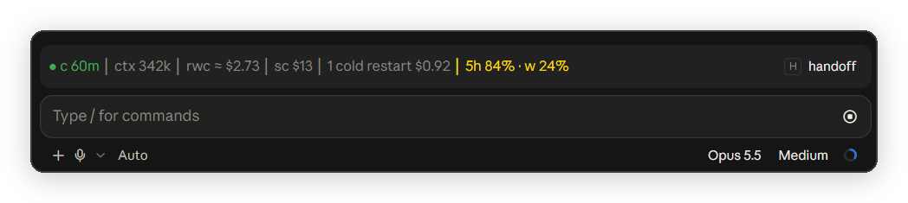

# session-band

A compact prompt-cache status band for Claude Code, with a cold-send guard, keep-warm, a board of all local chats, and handoffs to a fresh chat.

This is a fork of **Cache Keeper** by Nate Herk ([nateherkai/claude-code-mods](https://github.com/nateherkai/claude-code-mods)), MIT licensed. The cache logic, board, guard and handoff flow are his work. See [Changes from Cache Keeper](#changes-from-cache-keeper) for what this fork adds.



*The band above the prompt: cache warm for 60 minutes, 342k tokens in context, a cold rewrite would cost about $2.73, the session cost $13 so far, and the 5-hour and weekly plan limits.*

## Why

Every request re-reads the whole chat. From the prompt cache that costs a tenth of the normal input price. Once the cache expires (5 minutes or 1 hour idle, depending on your plan), the next message writes the whole chat into the cache again at up to 2x the input price. On a large chat that one message can cost a few dollars.

## Requirements

- Claude Code 2.1.287 or later, in the terminal or the Desktop app's Code tab. The VS Code chat does not draw the band; the [claude-status](../../extensions/claude-status) extension shows the same values in the VS Code status bar.
- Mods turned on for your account. `claude plugin test` in any folder answers "no hooks module to load" when mods can load.
- Do not install it next to Cache Keeper. Both register the same commands.
- For [autonomous mode](#autonomous-mode-a): the [session-handoff](../../skills/session-handoff) skill from this repository, installed in `~/.claude/skills/session-handoff`. The marketplace does not install skills, so copy it by hand (see its README).

## Install

```
/plugin marketplace add IT-BAER/claude-forge
/plugin install session-band@claude-forge
```

Start a new session afterwards.

## The band

`● c 60m │ ctx 342k │ rwc $2.73 │ sc $13 │ 5h 84% w 24%`

| Part | Meaning |
| --- | --- |
| `c 60m` | Prompt cache state and minutes until it expires. Yellow 5 minutes before expiry, red once cold. While keep-warm runs: `◆ c kept 7:12pm`, the time it stops. |
| `ctx` | Tokens in context. |
| `rwc` | Rewrite cost: what writing the context into the cache again would cost if it expires. |
| `sc` | Session cost so far, at API list prices. |
| `cr` | Cold restarts: how many sends rewrote an expired cache this session, and what they cost. Shown only after the first one. |
| `5h`, `w`, `fw` | 5-hour, weekly and per-model weekly (`fw` for Fable, the model's initial) plan limits used, each in its own colour. `5h`: yellow at 80 %, red at 95 %. Weekly windows follow a daily budget: day n of 7 (counted from the reset) allows n/7 of the week, so day 1 allows 14.3 %. Red once today's budget is used, yellow at 80 % of it. The per-model windows come from the plan usage endpoint (`/api/oauth/usage`, asked at most every 5 minutes), because the mod API does not pass them. |

Hover `c`, `ctx`, `rwc`, `sc` or `cr` for a one-line explanation above the band. Each starts with what the label stands for (`rwc = rewrite cost: ...`), and `c` names the state in full (kept, warm, cooling, cold). Hover the plan limits for what each window is and when it resets: `5h (5-hour window) resets 1:50pm (in 2h15m) · w (weekly, all models) resets Fri 9:00am (in 3d21h), budget today 57.1%`. On a subscription the prices show up as usage against your limits, not as a bill.

## Commands

- `/keepwarm [hours|off]` keeps this chat's cache warm, 4 hours by default, with a small ping shortly before it would expire.
- Cold-send guard: a message into a chat over 150k tokens after its cache expired asks first: Send anyway, Compact first, or Cancel.
- `/board` shows every local chat in one pane: waiting on you first, then working, then the ones whose cache cools soonest.
- `/handoff` (or the `handoff` button) runs the bundled `session-handoff` skill, then clears the chat and starts the fresh one from the handoff.
- The `A` button at the right end of the band toggles [autonomous mode](#autonomous-mode-a): handoffs are cleared and continued without you.
- `/cache` shows status and settings: `ttl 5|60|auto`, `guard on|off`, `big 150k`, `alerts [on|off]`, `toasts [on|off]`.
- Alerts are off by default. They are the unasked toasts: a big cache about to go cold, and another chat waiting on you. `/cache alerts` toggles them.
- Toasts are on by default. `/cache toasts off` mutes every toast of the band, errors included; the band and footer still show the state. `/cache toasts` toggles them.

## Autonomous mode (A)

Autonomous mode lets one chat work through a long task in several fresh contexts while you are away. Each time Claude ends a turn with a handoff, the band clears the chat and starts the next one from that handoff, without a click from you.

It needs the [session-handoff](../../skills/session-handoff) skill. That skill writes the handoff to a file under `~/.claude/handoffs/`, so the work state survives the clear and the fresh chat gets a one-line resume prompt. Its consume step marks the file `status: consumed`, so the band never continues the same handoff twice.

### Turn it on

Press `A` at the right end of the band. A toast confirms it. While A is on, the button is drawn as the primary button and the footer shows `autonomous`. Press `A` again to turn it off.

A lasts for the current Claude Code process only. It is not saved, so a restart or a new window starts with A off.

### What changes while A is on

- Each prompt carries one more hidden context block: nobody is at the keyboard, do not ask or wait for "proceed" or "go", decide with your own recommendation and continue. The continuation prompt after a clear ends with the same text. It is not a system prompt section, because the built-in `cc-plugin-sec-default` skips `prompt.compose` for installed mods; a turn that starts without a prompt (a task notification) does not get it.
- Every `AskUserQuestion` is refused. The refusal tells Claude to pick its recommended option and continue.
- After a handoff turn, the band does not ask "Clear and continue?". It does that by itself.

### The loop

1. Claude ends a turn and a handoff is ready. That is a handoff file written in this turn (by the session-handoff skill, or any file the band detects as a handoff), or the answer of a `/handoff` turn.
2. The band waits until the chat is idle: 3 seconds after the turn end, no permission prompt or question waiting on you, no background agents running, no handoff still queued.
3. The band runs `/clear` and sends the resume line as your message: `Continue from session handoff: read <file>, consume it with session-handoff, do not re-explore.`
4. The fresh chat consumes the handoff and works. If it ends with a new handoff, the loop goes to step 1.

The band does not tell Claude to write handoffs. A new handoff comes from you (`/handoff`, the `h` button), from a hook of your own (for example at a context size), or from the handoff itself, when its remaining steps say to hand off again.

### When A turns itself off

| Event | Toast |
| --- | --- |
| A turn ends without a handoff and with no background work left. Claude found nothing left to do, or the turn broke off. | `Autonomous mode off: the turn ended without a handoff.` |
| `/clear` failed. The band stops instead of retrying. | `Autonomous mode off: clear and continue failed.` |
| A third handoff is ready within 15 minutes, for example a chain of "check again later" handoffs. The band does not continue it; it waits for `c`. | `Autonomous mode off: 3 handoffs in 15 minutes, possible loop. The handoff waits for c.` |

Background work keeps A on when a turn ends without a handoff: a running subagent, or a background shell (started with `run_in_background`, or moved to the background by the Bash timeout). Claude Code wakes Claude when the task finishes, and that turn decides. The band forgets a shell when a turn starts with its task notification, or 2 hours after it started, because a notification Claude reads inside a busy turn is not visible to the band. Classic `Stop` hooks list background tasks too, but they do not reach a plugin you install where an organization manages Claude Code, so the band does not use them.

### Before you leave a chat on A

- Run the chat in auto mode, or with the permission rules it needs. Permission prompts still follow the permission mode, and the loop waits while one is open.
- The A prompt tells Claude not to wait for approval. Where your `CLAUDE.md` asks for a confirmation first (push, delete, deploy), Claude now decides by itself. To block an action for sure, use a deny rule in the permission settings, not an instruction.

## Changes from Cache Keeper

- Short band labels (`c`, `rwc`, `sc`, `w`) so the band fits next to the prompt, session cost before the plan limits.
- Hover help for the short labels. The help row opens above the band, so the hovered text does not move.
- Handoff files: when Claude writes a `session-handoff.md`, a `restart-packet.md` (also with a suffix, like `session-handoff-pve.md`) or a file under `handoffs/`, the band shows `handoff running` while Claude still works, and offers to clear and continue from that file once the turn ends. A message you send mid-turn does not drop it. Any header format works; only a header marked `status: consumed` (or another non-active status) is skipped. If a handoff turn ends on a short answer (a Stop hook added a tail), the last handoff file written in the session is used instead. The fresh chat gets a short "read this file" prompt instead of the whole text.
- Renamed to `session-band`. Data lives in `~/.claude/mods-data/session-band/`.
- Earlier versions of this fork were called `cache-status`. To switch, run `/plugin uninstall cache-status@claude-forge`, then install `session-band@claude-forge` and restart each chat. Nothing reads `~/.claude/mods-data/cache-status/` any more, so you can delete that folder once no chat runs the old mod.

## Where the data lives

Everything stays on your machine, under `~/.claude/mods-data/`. The mod makes no network calls of its own. Keep-warm pings are small model requests, sent only while `/keepwarm` is on.

## License

MIT. See [LICENSE](LICENSE). Original work copyright Nate Herk.
