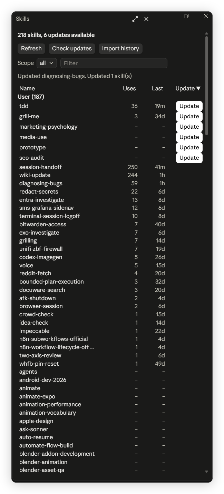

# skill-manager

A skill manager for Claude Code. It opens a pane that lists every installed skill (user, project and plugin), shows where each one came from and how often you used it, checks GitHub for newer versions, updates a skill from its source, and moves skills you no longer want to a trash folder.



*The pane sorted by Update: six skills have a newer version on GitHub. Uses and Last come from live counts plus the imported transcript history.*

## Install

Pick one way. All three need a new Claude Code session afterwards.

### 1. Plugin marketplace (recommended)

Run this in Claude Code:

```
/plugin marketplace add IT-BAER/claude-forge
/plugin install skill-manager@claude-forge
```

Or from a normal terminal:

```bash
claude plugin marketplace add IT-BAER/claude-forge
claude plugin install skill-manager@claude-forge
```

### 2. Copy the folder

```bash
git clone https://github.com/IT-BAER/claude-forge.git
mkdir -p ~/.claude/skills
rm -rf ~/.claude/skills/skill-manager
cp -r claude-forge/mods/skill-manager ~/.claude/skills/skill-manager
```

PowerShell:

```powershell
git clone https://github.com/IT-BAER/claude-forge.git
Remove-Item "$HOME\.claude\skills\skill-manager" -Recurse -Force -ErrorAction SilentlyContinue
Copy-Item claude-forge\mods\skill-manager "$HOME\.claude\skills\skill-manager" -Recurse
```

### 3. Try it for one session

```bash
claude --plugin-dir path/to/claude-forge/mods/skill-manager
```

## Use it

| Command | What it does |
| --- | --- |
| `/skill-manager` | Scan the skill folders and open the pane |

## Requirements

- Claude Code 2.1.x with the mod API, in the desktop app (Code tab) or the terminal.
- Node.js on the `PATH`. Import history and Delete run small Node scripts.
- For updates of GitHub skills: `npx` and skills installed with the [`skills` CLI](https://github.com/vercel-labs/skills), which records their source in `~/.agents/.skill-lock.json` (or `skills-lock.json` in a project).
- Tested on Windows. The code handles `/` paths, but other systems were not tested.

## Features

### The list

- Sections: User (`~/.claude/skills`), Project (`.claude/skills` in the session's folder), and one section per plugin. Each title shows its count.
- Columns: Name, Uses, Last (time since the last use) and Update. Click a column header to sort by it; click it again to reverse. An arrow marks the sorted column.
- Scope filter (all, user, project, plugin) and a text filter that matches names and descriptions.
- The pane draws only the rows near the scroll position, so a list of hundreds or thousands of skills scrolls without pages.
- Buttons: Refresh (scan again), Check updates, Import history.

### Usage counts

- Every skill run in a session with the mod counts at once, with its time.
- Import history reads your past transcripts in `~/.claude/projects` once and adds the Skill tool calls and typed slash commands found there. Each call counts once. Running it again never lowers a count.

### Updates

- Check updates asks the GitHub contents API, once per repository folder, whether the skill folder changed since install (git tree SHA against the lock file's `skillFolderHash`). Rows with a newer version get an Update button.
- Update for a GitHub skill runs `npx -y skills update <folder> -g -y` (`-p` for a project skill). Update for a plugin skill runs `claude plugin update <plugin>@<marketplace>`; restart Claude Code to load it.
- While an update runs, its row shows "Updating…" and the other Update buttons are disabled.

### Details and delete

Click a name for the details: description, scope, path, source with install date, uses, and the update state. When files changed after the install, the details say so, because an update overwrites them.

Delete asks a second time, then moves the folder to `.trash/<name>-<timestamp>` in the same skills folder. Nothing is deleted for good: move the folder back to restore the skill. Plugin skills cannot be deleted here; uninstall the plugin instead.

## Limits

- GitHub allows 60 unauthenticated API calls per hour. Check updates needs one call per repository folder.
- Delete does not remove the skill's entry from the `skills` CLI lock file.
- Project skills are read only from the session's own folder, not from its parent folders.
- If `~/.codex/skills` or `~/.agents/skills` link to `~/.claude/skills`, Delete and Update affect those tools too.
- The pane needs Claude Code's mod API, which changes between releases. After an upgrade the mod can need an update.

## License

MIT, see the repository root.
