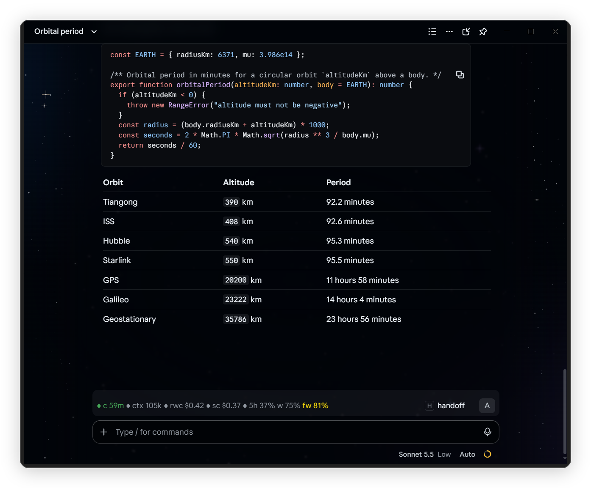
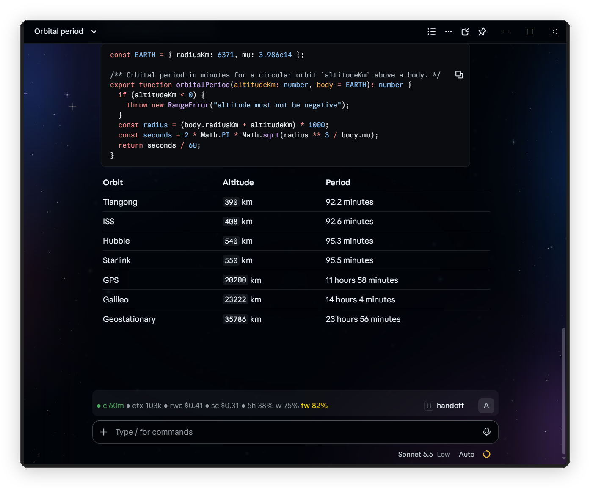
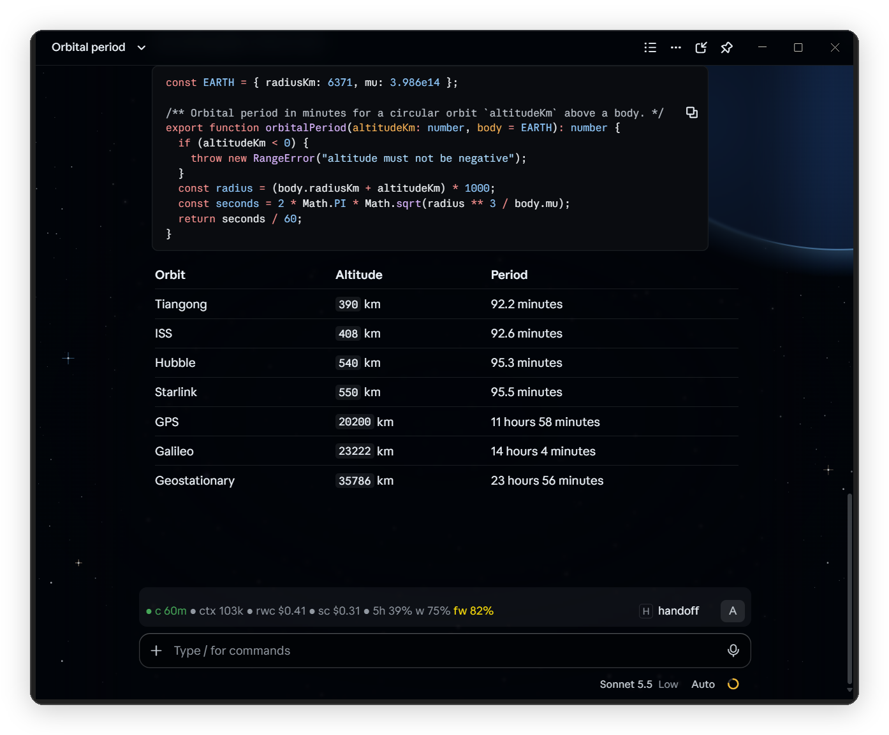
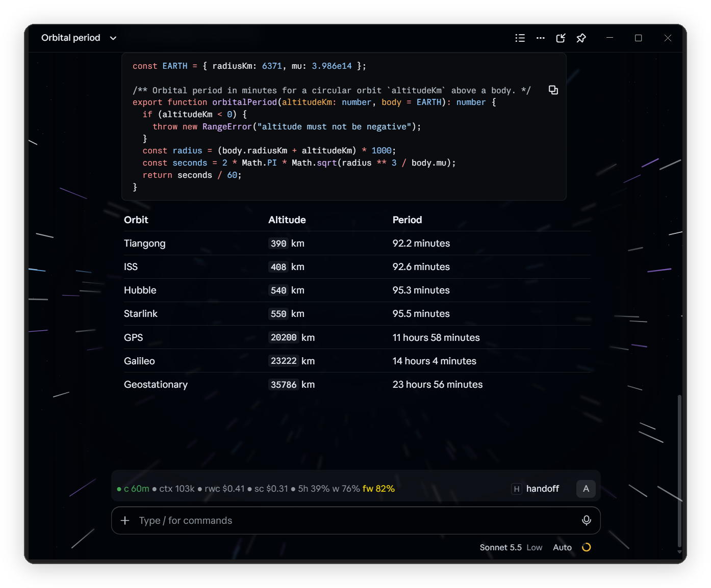

# themes

A Claude Code mod with color themes for Claude Desktop. `/themes` switches between them, and the choice is kept for later sessions.


*GitHub Dark in a Claude Desktop session window.*

| Theme | Name for `/themes` | Modes |
| --- | --- | --- |
| [GitHub Dark](#github-dark) | `github-dark` | dark only |
| [Space Deep Field](#space-themes) | `space-stars` | dark only, animated |
| [Space Nebula](#space-themes) | `space-nebula` | dark only, animated |
| [Space Orbit](#space-themes) | `space-orbit` | dark only, animated |
| [Space Warp](#space-themes) | `space-warp` | dark only, animated |

## Switch themes

```
/themes
/themes github-dark
/themes space-nebula
/themes off
```

`/themes` alone lists the themes and names the current one. `/themes <name>` switches to that theme. `/themes off` returns to the app's own look until you pick a theme again. A fresh install starts with GitHub Dark. The command also runs while Claude is still answering. In Claude Desktop the window of the session where you type the command repaints at once, in both directions (tested on 14 November 2026).

## GitHub Dark

The dark look of github.com, with the colors of GitHub's design system (`@primer/primitives` 11.10.0, `functional/themes/dark.css`).

- Chat page, title bar, prompt area and question panel #010409, like the github.com page; the app draws the sidebar from the same color a little darker. Prompt box, panels and menus #0d1117.
- Text #f0f6fc, muted text #9198a1.
- Accent, danger, success, warning and "done" colors from GitHub's palette, with GitHub's button fills: blue #1f6feb, green #238636, red #da3633, purple #8957e5.
- Git state colors as on github.com: added #3fb950, removed #f85149, modified #d29922, merged #ab7df8, conflicting #db6d28.
- Code blocks use GitHub's `github-dark-high-contrast` highlighting theme. Desktop's chat highlighter has no `github-dark-default`, and this is the closest one it has: the same token hues, a little brighter, on #0a0c10.

Dark mode only. With the app in light mode, the app keeps its own light colors. The terminal and the VS Code extension draw no themes, so the mod changes nothing there.

### Status in Claude Desktop

Tested on 14 November 2026 with Claude Desktop 5.11492.5.0 (Code tab, Claude Code 2.1.325), by capturing the window and comparing it with github.com. Desktop draws one look for the whole window. After a Desktop restart the look drew at startup; before the restart, a newly opened session alone did not bring it.

In split view, Desktop draws the look of the session in the left pane. An empty New session page there shows the app's own look; close it or open a session in it.

Where Desktop's fixed design differs from github.com:

- The title bar, prompt area and sidebar share one color slot, and the app draws the sidebar 20% darker: the sidebar is #010307, where github.com has #0d1117.
- The selected sidebar row (#25282c) is a little brighter and card borders (#191d21) are fainter than github.com's #1f232a and #3d444d, because the app draws them as fixed white overlays.
- Code blocks use the `github-dark-high-contrast` background #0a0c10, not github.com's #151b23.

## Space themes

Four themes with the GitHub Dark colors and a moving scene behind the conversation. The app lays its panels over the scene as dark glass (tint #010409, 60% opaque, blur 2), so text keeps close to the GitHub Dark contrast.



*Space Deep Field (`space-stars`) in a Claude Desktop session window.*



*Space Nebula (`space-nebula`).*



*Space Orbit (`space-orbit`).*



*Space Warp (`space-warp`).*

| Name | Scene | Motion |
| --- | --- | --- |
| `space-stars` | A deep field of stars in three depths | Layers slide at different speeds, stars fade down and up, a meteor crosses about twice a minute |
| `space-nebula` | The starfield behind blue, purple and pink clouds in the corners | Clouds breathe slowly, stars slide and fade, a meteor crosses about every 100 seconds |
| `space-orbit` | The lit edge of a planet in the top right corner, with a moon | The moon circles the planet in 10 minutes, the planet's air glows, stars fade down and up |
| `space-warp` | Streaks of starlight that run outward from the middle | Wave after wave, each from the middle to past the edge in 40 seconds; the strongest motion of the four |

Each scene is one SVG that the mod builds as a string and the app draws in a sandboxed frame. It runs no script and loads nothing; CSS inside the SVG moves it. Every build draws the same sky.

- Motion stops when the system asks for reduced motion (Windows: Settings, Accessibility, Visual effects, Animation effects off). The scene then rests as a still picture.
- The middle of the window, where the text sits, and the foot, where the prompt box sits, are dimmed in every scene.
- The terminal and the VS Code extension draw no scene.

### Status and cost in Claude Desktop

Tested on 15 November 2026 with Claude Desktop 5.11492.5 (Code tab, Claude Code 2.1.325) on Windows 11 with a 164 Hz display, by setting each theme in a session and capturing the window. All four scenes drew behind the conversation, and the text stayed readable.

The scenes move in 20 steps a second on one shared grid, and only the meteor moves on every frame. This is on purpose: the app redraws the window whenever the scene changes, so motion on every frame of a fast display costs more than it shows, and a first version with one step a second looked like stutter.

Measured in an idle session in a 1143x884 window, three samples of 2.5 seconds for each scene. "Changes" counts how often a strip of the scene differed between window captures taken about 55 times a second. "GPU" is the CPU use of the app's GPU process in percent of one core.

| Look | Changes a second | GPU |
| --- | --- | --- |
| No scene (GitHub Dark) | 0 | 6 |
| A scene that does not move | 0 | 6 |
| The four space themes | 18 to 21 | 16 to 25 |
| A test scene that moves on every frame | 50 to 54, the capture limit | 30 |
| The first version, one step a second | 2 | not measured this way |

The CPU use of the app's renderer process ranged from 31 to 68 percent of one core in these runs, with no relation to the scene, so it is not in the table. Frosted glass against no glass made no measurable difference in a paired test (8 and 9 samples). A larger window was not measured this way.

## Install

```
/plugin install themes@claude-forge
```

Restart Claude Desktop after installing. The mod sets the stored theme when a session starts.

## Remove

```bash
claude plugin uninstall themes@claude-forge
```

The app returns to its own look when the mod is gone.

## Add a theme

1. Add `hooks/themes/<name>.ts` that exports `{ id, label, look }`, with `look` built by `makeColors` like `hooks/themes/github-dark.ts`.
2. Add it to `THEMES` in `hooks/register.ts`. The first entry is the default for a fresh install.
3. Add a test for its colors in `tests/look.test.ts`.

A theme with a moving scene also gives `alt` and `scene`, a function that returns the SVG, like the entries in `hooks/themes/space.ts`; the `Backdrop` hook in `hooks/register.ts` draws it. `tests/space.test.ts` holds the rules a scene must keep.

## Tests

```
claude plugin test mods/themes
```

`hooks/make-colors.js` and `hooks/make-colors.d.ts` are copied unchanged from Claude Code's `plugin-authoring` skill (Claude Code 2.1.325). They turn a few seed colors into the app's full palette and check contrast. Copy them again after a Claude Code update, because an old copy can fall behind the app's design system.

<br>

## 💜 Support

If you like this Project, consider supporting this and future work, which heavily relies on coffee:

<div align="center">
<a href="https://www.buymeacoffee.com/itbaer" target="_blank"></a>
<br>
<a href="https://www.paypal.com/donate/?hosted_button_id=5XXRC7THMTRRS" target="_blank">Donate via PayPal</a>
</div>
