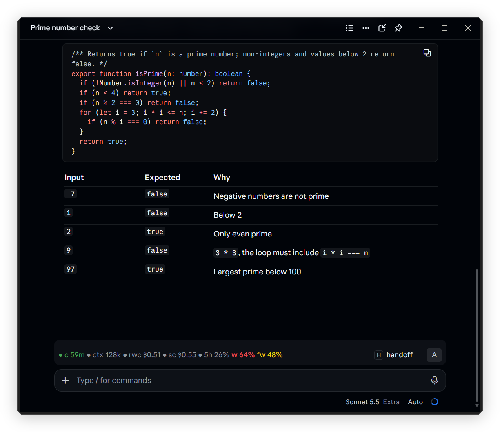

# themes

A Claude Code mod with color themes for the Claude desktop and mobile apps. `/themes` switches between them, and the choice is kept for later sessions.



*GitHub Dark in a Claude Desktop session window.*

| Theme | Name for `/themes` | Modes |
| --- | --- | --- |
| [GitHub Dark](#github-dark) | `github-dark` | dark only |

## Switch themes

```
/themes
/themes github-dark
/themes off
```

`/themes` alone lists the themes and names the current one. `/themes <name>` switches to that theme. `/themes off` returns to the app's own look until you pick a theme again. A fresh install starts with GitHub Dark. The command also runs while Claude is still answering. In Claude Desktop the window of the session where you type the command repaints at once, in both directions (tested on 14 November 2026).

## GitHub Dark

The dark look of github.com, with the colors of GitHub's design system (`@primer/primitives` 11.10.0, `functional/themes/dark.css`).

- Chat page, title bar, prompt area and question panel #010409, like the github.com page; the app draws the sidebar from the same color a little darker. Prompt box, panels and menus #0d1117.
- Text #f0f6fc, muted text #9198a1.
- Accent, danger, success, warning and "done" colors from GitHub's palette, with GitHub's button fills: blue #1f6feb, green #238636, red #da3633, purple #8957e5.
- Git state colors as on github.com: added #3fb950, removed #f85149, modified #d29922, merged #ab7df8, conflicting #db6d28.
- Code blocks use GitHub's `github-dark-high-contrast` highlighting theme. Desktop's chat highlighter has no `github-dark-default`, and this is the closest one it has: the same token hues, a little brighter, on #0a0c10.

Dark mode only. With the app in light mode, the app keeps its own light colors. The terminal and the VS Code extension draw no themes, so the mod changes nothing there.

### Status in Claude Desktop

Tested on 14 November 2026 with Claude Desktop 5.11492.5.0 (Code tab, Claude Code 2.1.325), by capturing the window and comparing it with github.com. Desktop draws one look for the whole window. After a Desktop restart the look drew at startup; before the restart, a newly opened session alone did not bring it. The mobile apps were not tested.

Where Desktop's fixed design differs from github.com:

- The title bar, prompt area and sidebar share one color slot, and the app draws the sidebar 20% darker: the sidebar is #010307, where github.com has #0d1117.
- The selected sidebar row (#25282c) is a little brighter and card borders (#191d21) are fainter than github.com's #1f232a and #3d444d, because the app draws them as fixed white overlays.
- Code blocks use the `github-dark-high-contrast` background #0a0c10, not github.com's #151b23.

## Install

```
/plugin install themes@claude-forge
```

Restart Claude Desktop after installing. The mod sets the stored theme when a session starts.

## Remove

```bash
claude plugin uninstall themes@claude-forge
```

The app returns to its own look when the mod is gone.

## Add a theme

1. Add `hooks/themes/<name>.ts` that exports `{ id, label, look }`, with `look` built by `makeColors` like `hooks/themes/github-dark.ts`.
2. Add it to `THEMES` in `hooks/register.ts`. The first entry is the default for a fresh install.
3. Add a test for its colors in `tests/look.test.ts`.

## Tests

```
claude plugin test mods/themes
```

`hooks/make-colors.js` and `hooks/make-colors.d.ts` are copied unchanged from Claude Code's `plugin-authoring` skill (Claude Code 2.1.325). They turn a few seed colors into the app's full palette and check contrast. Copy them again after a Claude Code update, because an old copy can fall behind the app's design system.
